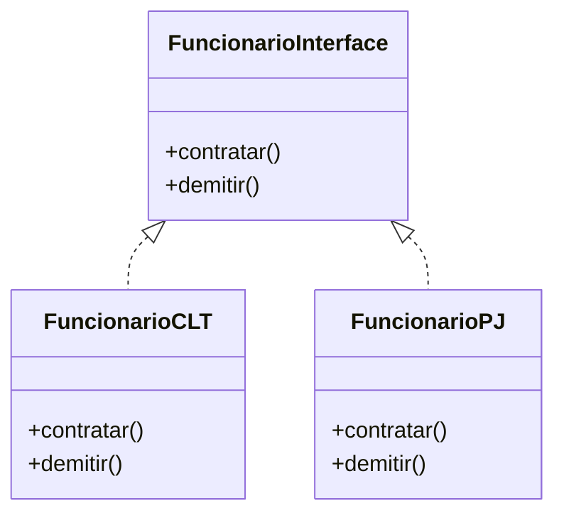

# Diagrama de funcionários

Uma interface define métodos que as classes que a implementam devem possuir.
Neste exercício, FuncionarioCLT e FuncionarioPJ implementam
FuncionarioInterface, que declara os métodos contratar() e demitir().

## Perguntas

### O que é uma interface?

É um contrato que declara métodos que as classes implementadoras devem
oferecer. Neste exercício, qualquer classe que implemente
`FuncionarioInterface` precisa definir `contratar()` e `demitir()`.

### Qual é a diferença entre classe abstrata e interface?

Uma classe abstrata pode reunir atributos, implementação de métodos e métodos
abstratos para suas subclasses. Uma interface define principalmente um
contrato de métodos, sem representar uma classe-base com estado compartilhado.
Em PHP, uma classe pode herdar de apenas uma classe, mas pode implementar
múltiplas interfaces.

### Por que interfaces ajudam no trabalho em equipe?

Elas permitem que a equipe combine previamente quais métodos cada componente
deve oferecer. Assim, pessoas diferentes podem implementar classes distintas
seguindo o mesmo contrato, facilitando a integração do código.

### Como interfaces ajudam a entender o sistema mais rápido?

Ao olhar para uma interface, é possível identificar rapidamente quais operações
uma classe deve oferecer, sem precisar conhecer todos os detalhes internos da
implementação.

### O que acontece se uma classe não seguir o contrato?

Se uma classe declarar que implementa uma interface e não definir todos os
métodos exigidos com as assinaturas compatíveis, o PHP gera um erro e não
permite que a classe seja usada normalmente.

